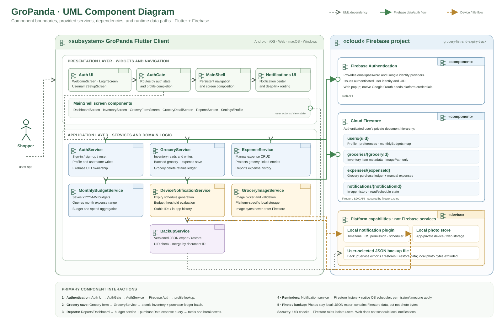
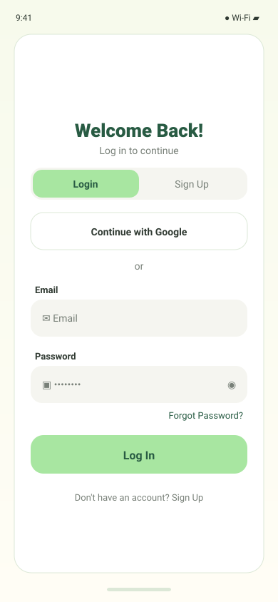
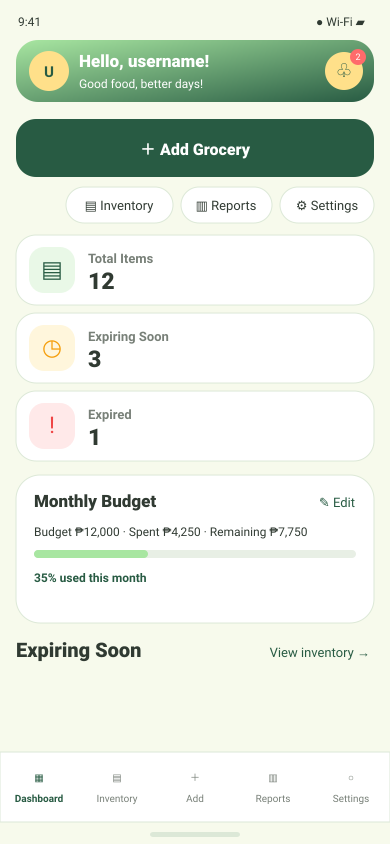
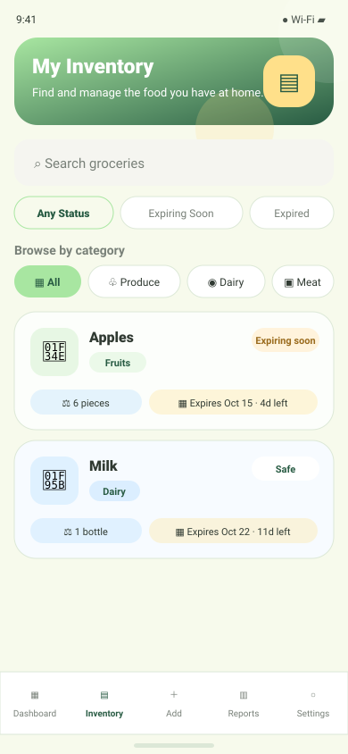
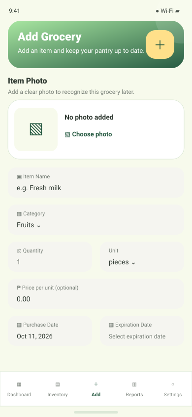
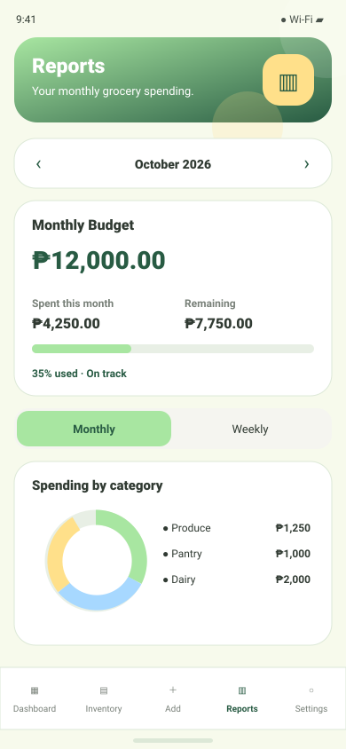
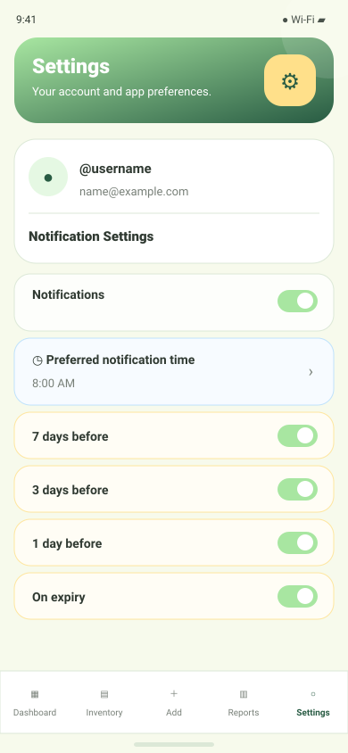
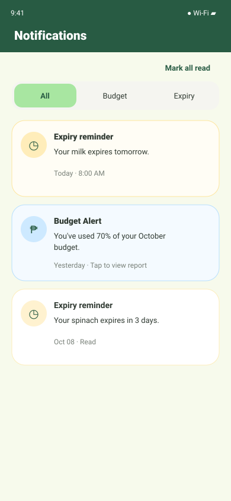

# GroPanda System Design

This document describes the current Flutter and Firebase implementation. The
database is Cloud Firestore, a document database; the schema below therefore
describes collections and documents rather than relational tables.

Printable copy: [SYSTEM_DESIGN.pdf](SYSTEM_DESIGN.pdf). Regenerate it after
editing this document by running `python3 docs/export_system_design_pdf.py` from
the repository root. The exporter uses local Google Chrome and Python's standard
library; it does not upload the document.

## 1. System architecture



This uses a UML/Lucidchart-style component notation: component glyphs and
component boundaries show deployable/runtime responsibilities; dashed
dependency arrows show which component calls another; labeled Firebase and
device flows distinguish cloud data access from local capabilities. The
diagram's interaction notes summarize the sign-in, grocery, reporting,
reminder, photo, and backup paths. The Flutter client talks directly to Firebase
through the Firebase SDK; there is no separate application server.

### Main data flows

1. Firebase Authentication signs the user in. The auth gate loads
   `users/{uid}` and sends users without a username to username setup.
2. The main shell presents Dashboard, Inventory, Add, Reports, and Settings.
   Screen-level services access records beneath the current user's UID.
3. Saving a grocery writes the grocery document and its expense-ledger entry
   together in a Firestore batch. Updating a grocery updates both documents.
   Deleting a grocery deletes the inventory item but intentionally retains the
   expense history.
4. The app schedules expiry alerts on supported native platforms using device
   local notifications. Notification history and budget alerts are stored in
   Firestore. Web does not schedule device notifications.
5. Grocery image bytes remain in app-private local storage. Firestore stores
   only the local `imagePath`; images do not sync to other devices and are not
   included in JSON backups.
6. Backup export and restore are initiated by the user. Restore merges matching
   document IDs and only accepts a backup belonging to the signed-in UID.

## 2. Firestore data model

All user-owned data is rooted at the authenticated UID:

```text
users/{uid}
  groceries/{groceryId}
  expenses/{expenseId}
  notifications/{notificationId}
```

`{uid}` is the Firebase Authentication UID. The security rules in
[`firestore.rules`](../firestore.rules) allow a signed-in user to read and write
only their own user document and subcollections.

### `users/{uid}` — profile and preferences

| Field | Type | Description |
| --- | --- | --- |
| `uid` | string | Firebase Authentication UID. |
| `email` | string, optional | Account email. |
| `displayName` | string, optional | Provider display name. |
| `photoURL` | string, optional | Provider profile image URL. |
| `username` | string, optional until onboarding | Public-facing username; 3–20 letters, numbers, or underscores. |
| `usernameLower` | string, optional | Lowercase username value saved for normalized lookup. |
| `profileCompleted` | boolean | Whether username setup has completed. |
| `createdAt` | timestamp | Account profile creation time. |
| `lastLoginAt` | timestamp, optional | Last Google sign-in time when available. |
| `updatedAt` | timestamp, optional | Last profile or budget update. |
| `monthlyBudget` | number, optional | Legacy/current-month budget value. |
| `monthlyBudgets` | map of `YYYY-MM` to number, optional | Per-month budget amounts. |
| `notificationEnabled` | boolean | Master notification preference; defaults to true. |
| `notificationTime` | string (`HH:mm`) | Local preferred notification time; defaults to `08:00`. |
| `expiryReminder7Days` | boolean | Enable reminder seven days before expiry. |
| `expiryReminder3Days` | boolean | Enable reminder three days before expiry. |
| `expiryReminder1Day` | boolean | Enable reminder one day before expiry. |
| `expiryReminderOnExpiry` | boolean | Enable reminder on the expiry date. |
| `budgetAlert70` | boolean | Enable 70% budget threshold alert. |
| `budgetAlert90` | boolean | Enable 90% budget threshold alert. |
| `budgetAlert100` | boolean | Enable 100% budget threshold alert. |
| `budgetAlertOver100` | boolean | Enable over-budget alert. |

Budget map example:

```json
{
  "monthlyBudget": 12000,
  "monthlyBudgets": {
    "2026-10": 12000,
    "2026-11": 13500
  }
}
```

### `users/{uid}/groceries/{groceryId}` — inventory item

| Field | Type | Description |
| --- | --- | --- |
| `name` | string | Grocery name. |
| `category` | string | Category such as Fruits, Dairy, Pantry, or Other. |
| `quantity` | number | Amount owned. |
| `unitPrice` | number | Price per unit; defaults to zero if not supplied. |
| `unit` | string | Unit such as pieces, packs, kg, or liters. |
| `purchaseDate` | timestamp | Date purchased. |
| `expirationDate` | timestamp | Expiry date; used for ordering and reminders. |
| `storageLocation` | string | Location such as fridge, freezer, or pantry. |
| `notes` | string | Optional free-form notes (stored as an empty string when blank). |
| `createdAt` | timestamp | Creation time, set by the server on add. |
| `updatedAt` | timestamp | Last update time, set by the server. |
| `imagePath` | string or null | Device-local photo path; photo bytes are not in Firestore. |

The document ID is generated by Firestore before the first write and is reused
for updates. The item total cost is calculated as `quantity * unitPrice`; it is
not stored as a separate grocery field.

### `users/{uid}/expenses/{expenseId}` — spending ledger

Grocery-linked expenses use the grocery document ID as `expenseId`. They are
written atomically with the grocery record, so editing the item updates its
ledger entry. Removing the inventory item does not remove the expense.

| Field | Type | Description |
| --- | --- | --- |
| `userId` | string | Owning Firebase UID. |
| `groceryId` | string, optional | Present for grocery-linked purchases; absent for manual expenses. |
| `name` | string | Expense name; maintained for compatibility/display. |
| `description` | string | User-facing expense description. |
| `amount` | number | Total expense amount. |
| `category` | string | Expense category. |
| `date` | timestamp | Expense date; stored for both expense kinds. |
| `purchaseDate` | timestamp | Date used by monthly report and budget queries. |
| `source` | string, optional | Manual expenses use `manual`; grocery-linked records are identified by `groceryId`. |
| `createdAt` | timestamp | Creation time. |
| `updatedAt` | timestamp | Last update time. |

Manual expenses receive an automatically generated document ID and can be
edited or deleted from Reports. Grocery-linked expenses must be changed through
their grocery item.

### `users/{uid}/notifications/{notificationId}` — in-app notification history

Notification IDs are deterministic for expiry reminders and budget thresholds,
which prevents duplicate records for the same event.

| Field | Type | Description |
| --- | --- | --- |
| `userId` | string | Owning Firebase UID. |
| `type` | string | `expiry` or `budget`. |
| `title` | string, optional | Stored on budget notifications; the UI supplies a fallback title otherwise. |
| `message` | string | Notification content shown in the app. |
| `createdAt` | timestamp | Notification record creation time. |
| `read` | boolean | Whether the user has read the notification. |
| `itemId` | string, expiry only | Grocery document ID to open. |
| `itemName` | string, expiry only | Grocery name at scheduling time. |
| `expiryDate` | timestamp, expiry only | Expiration date the reminder refers to. |
| `scheduledAt` | timestamp, expiry only | Local reminder target time represented as a Firestore timestamp. |
| `reminderScheduled` | boolean, expiry only | Whether a local reminder was scheduled. |
| `reminderSent` | boolean, expiry only | Whether the reminder has already been delivered/handled. |
| `month` | string (`YYYY-MM`), budget only | Budget month. |
| `threshold` | number, budget only | Threshold percentage (70, 90, 100, or 101 for exceeded). |
| `budgetAmount` | number, budget only | Budget configured for the month. |
| `amountSpent` | number, budget only | Spend at threshold evaluation time. |
| `percentage` | number, budget only | Percentage of budget spent. |
| `phoneNotificationShown` | boolean, budget only | Whether a native alert was shown. |

## 3. Queries and operational notes

- Inventory streams are ordered by `expirationDate`.
- The notification center orders by `createdAt` descending and reads at most
  100 records.
- Monthly reports and budget alerts filter expenses by `purchaseDate` between
  the first day of the month and the first day of the next month.
- Firestore automatic single-field indexing is used by these current queries.
  Revisit index requirements if query shapes change.
- All timestamps are Firestore `Timestamp` values. Budget map keys use
  zero-padded `YYYY-MM`.
- The current rules enforce owner UID isolation, but they do not validate field
  types, required fields, or value ranges. Add Firestore field validation before
  enabling untrusted clients or introducing additional write paths.

## 4. Visual wireframes

These mobile wireframes have been revised to reflect the current screen
structure, controls, content, and theme in the Flutter implementation. They
remain illustrative rather than pixel-perfect renderings: data is representative
and long pages show only their initial viewport.

### Welcome and authentication




### Main app












